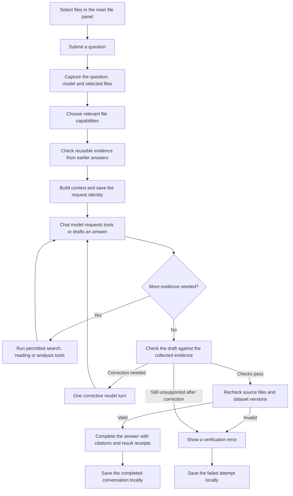

# Selected files: from question to final answer

This guide describes the current directory chat in Nawa: what happens when you select files, submit a question, and receive an answer.

The normal workflow is **open a directory → select files → ask a question**. Click **Index** when you want to prepare those files for search and analysis. Settings are available through the chat gear, which opens **Settings → Knowledge**.

For a local Agents-A1-4B chat server and the recommended 4 GB GPU starting profile, see [Local llama.cpp setup](LOCAL_LLAMA_CPP.md). The chat model can run locally through an OpenAI-compatible API; native tools still read and calculate over the selected sources.

## 1. The complete flow

The tool path depends on the question. A file-listing request can finish without reading file contents. A calculation usually needs several tool calls. The diagram describes a successful request and its verification failures; cancellation, connection errors and processing limits can interrupt it earlier.

## 2. Capture the selection when Send is clicked

Nawa captures the question, chosen chat model, opened directory, selected files and selected directories. This selection stays fixed for that request. Changes you make in the main file panel apply to your next question.

Only individually selected files can supply content. Opening or selecting a directory allows listing its immediate children and metadata. To read one of those children, select that file in the main panel.

Nawa adds your question and a streaming assistant message to the conversation. An activity record tracks the request, model calls, tool calls and verification steps.

## 3. Choose capabilities for the question

Nawa uses the question and selected filenames to choose an initial set of tools. These routing rules guide tool availability; the model can discover additional capabilities when needed. Discovering tools keeps the original file permissions.

Count requests recognize common “how many” misspellings, including “how may employee in employee-data.xlsx”, while preserving modal questions such as “how may I inspect this file”. Numerical questions about a named selected file receive source-checked native dataset IDs, readiness and actual column metadata before the first model call. This read-only catalog does not reimport Ready data or supply the final numerical answer. The agent must execute a native query and use its receipt; a basic included-record count needs no column. It checks the actual schema before asking the user to identify a column, and clears a rejected draft before presenting a corrected answer.

| Question                                            | Main path                                          | Evidence used for the answer                                  |
| --------------------------------------------------- | -------------------------------------------------- | ------------------------------------------------------------- |
| “List selected files”                               | Selection metadata                                 | Selected names and paths                                      |
| “What does this workbook contain?”                  | Workbook metadata, with native reading when needed | Returned sheet, table and column information; coverage limits |
| “Which file mentions this topic?”                   | Content search                                     | Retrieved passages and their locations                        |
| “What exactly does this paragraph say?”             | Direct native reading                              | The relevant saved source passage                             |
| “What is the value or formula in this cell?”        | Native workbook reading                            | The saved cell value or formula                               |
| “How many records?” or “Average amount by product?” | Native table analysis                              | A query result, population details and result receipt         |
| “Why did sales decline?”                            | Analysis plus relevant document search             | Measured change and any supporting explanation                |
| “Update this file”                                  | File-action tools                                  | A reviewed proposal and confirmed action receipt              |

For a named workbook overview, Nawa can prepare metadata through optional MyAgent tools before the first model call. Most questions begin with local capabilities and discover optional server tools on demand.

## 4. Check earlier answers before reusing them

For content questions, Nawa checks eligible completed answers from the same selection context. It verifies that their files remain accessible and that recorded source hashes and applicable dataset or server revisions are current.

Accepted evidence can support follow-up questions and reuse existing table identities. Changed or unavailable evidence is excluded from restored answer context. Earlier user requests remain reference information; they do not become new file actions.

Host-produced per-file action receipts are stored separately from model answers. They survive a failed or cancelled request and are supplied as historical checkpoints within the same selection. An explicit “resume” skips an exact completed proposal, matched by a saved SHA-256 digest of its full arguments. A different instruction or workflow for the same file still needs a fresh proposal. Older receipts without a proposal digest provide context but are not automatically reused. Partial outcomes remain visible and require a fresh proposal/review before further changes. A historical save receipt does not establish the file's current contents or grant new read access.

Before the first chat-model request, Nawa saves the current request identity to local conversation history.

## 5. Let the chat model request evidence

The chat model receives the question, selected-file context, relevant tool definitions and any accepted prior evidence. It can request tools, read their results and request more tools before drafting the answer.

Numerical requests receive a bounded, source-checked table catalog before the first model call, including questions spanning multiple selected files. Ready table IDs and available columns let the model calculate directly. Omitted schemas, column pages and file statuses remain explicit; the model discovers further metadata only when needed. Compatible metrics share one query, and independent calculations can run within one model tool turn. Native readers supply formulas, definitions and source records when those details are needed.

Routine analytical responses retain exact values, population coverage, warnings, source versions and receipt IDs. Chat previews show at most 20 result rows and label omitted output. Detailed SQL, parameters and request records remain in the saved receipt and can be retrieved with `inspect_result`; it is optional after a successful calculation. This reduces repeated context without changing calculation inputs or final source verification.

The chat model writes the answer; the embedding model helps match questions to indexed passages. Each has its own configuration. The configured chat provider receives the request context and tool outputs, and may run locally or remotely. Choosing llama.cpp for embeddings preserves your separate chat-model choice.

The tools run through Nawa's local application bridge. The background service checks request ownership, registered workspace access, selected paths and tool-specific limits. The model receives bounded results and source references.

The chosen Local or Cloud profile carries its own context/output limits. Local defaults are 16,384 / 4,096 tokens; cloud starting defaults are 65,536 / 8,192. Recognized cloud model families use cloud defaults even through a localhost gateway; an explicit profile mode takes precedence. Directory chat and staged edits share a loop policy, and all model dispatches budget system instructions, tools, history and output space. Completed exchanges can be dropped together; bounded previews retain receipts and mark omissions. Oversized active input is rejected. OpenAI/GPT cloud requests use local tokenizer estimates with reserves. Local llama.cpp can supply rendered chat token counts; unknown tokenizers and images retain conservative estimates. Settings → AI Model → the selected model's limits controls the configured ceiling, which must fit the actual server. See the [local setup guide](LOCAL_LLAMA_CPP.md).

The selected provider stays selected on errors. Gemini's current tool turn retains its original ordered parts and opaque signatures through IPC; completed history is portable prose/evidence, rather than a signed transcript replayed to a different model. **Test model** in Settings checks tool calling and tool-result handling, plus image understanding when explicitly requested. It does not certify every file task.

### Search: find relevant context

`search_contents` searches selected files using the configured search backend. With native RAG, indexed passages are matched using embeddings and keyword search. Results include passages, file identities and available page, sheet, slide or section locations.

Search supplies candidate context. An exact quote or saved cell value requires a direct source read. Whole-table totals require an analytical query. A missing search hit leaves the presence of information unresolved.

When indexing is unavailable or stale, native reading can still answer questions supported by its readers. If retrieval is necessary, Nawa reports the indexing requirement.

### Native reading: check saved content

`inspect_file` opens a saved file snapshot and advertises the read tools supported by that format. `query_file` calls one of those tools to read blocks, cells, ranges, slides or other available structure. `read_file` provides bounded extracted text when appropriate.

These reads use saved files. Unsaved changes in an open editor are outside that saved snapshot. Extraction and OCR have format-specific limits; recognized OCR wording must be identified as such unless visually verified.

### Native analysis: calculate over eligible table data

The analytical tools discover datasets, describe their policies and query Ready tables in Nawa's local SQLite store. If preparation is needed, the agent can prepare tables when saved settings authorize it. Tables requiring a decision remain subject to review.

- `query_data` performs structured filters, grouping and aggregates.
- `analyze_data` provides supported statistical analyses.
- `query_sql` accepts restricted, read-only SQLite queries over authorized Ready datasets.

Calculations operate on the relevant included table population and filters. A result display limit can shorten the returned rows while aggregation still covers the full eligible input. Results record sources, source hashes, dataset generations, population details, warnings and a receipt ID.

Typed aggregate tools support exact integer and decimal arithmetic. General SQL must respect stored decimal scales; SQLite `AVG` and floating-point math are approximate. Saved formula caches require the applicable policy decision and are not recalculated by ingestion.

### Optional MyAgent tools

When the MyAgent backend is enabled, Nawa can discover and invoke its document and knowledge tools. Content execution requires suitable current server indexing for the targeted files. Native reading and native table analysis can operate independently of that server.

## 6. Verify the draft and its sources

Text may stream while the request is still running. Completion follows these checks:

1. **Evidence checks:** relevant routes require a direct read for exact saved content and a native analytical receipt for numerical conclusions. Recognized quote patterns, including Unicode quotation marks, are checked against collected direct text. Receipt checks also follow executed analytical tools when intent routing did not classify a calculation. Arabic, Japanese and Chinese patterns supplement English routing and claim checks; these checks are not a universal semantic proof of arbitrary prose. Analytical answers must show their primary result ID and account for truncated grouped output.
2. **Correction:** a failed draft check can trigger one corrective model turn. Persistent missing evidence prevents successful completion.
3. **Source consistency:** Nawa rechecks collected file evidence and applicable native dataset generations or MyAgent source revisions. Mixed or changed revisions produce a verification error.

Verification covers source consistency and the implemented evidence checks. OCR quality, source-data errors and business interpretation still require their documented qualifications.

For example, a table policy stating “One source data record” establishes a structural row count. An employee count also needs a justified interpretation of those rows. The answer should give the mechanical count first and make the employee interpretation conditional when necessary.

## 7. Complete and save the answer

After successful validation, Nawa marks the response completed, attaches collected citations and stores its verified evidence in local conversation history. Analytical answers include a visible result receipt ID. Source links allow inspection of supporting evidence.

The activity summary can be expanded to inspect tool steps. Technical model timings, verification details and storage diagnostics are available on demand. If local conversation saving fails, Nawa exposes a retry instead of marking the save successful.

On a later question, Nawa can reuse this answer's evidence after checking it again.

## 8. Where the Index button fits

Index is a separate preparation action. It does not submit a question or call the chat model.

Successfully prepared selected files are enrolled in background refresh. Nawa persists only those exact paths and the embedding profile used for their search index. Directory notifications trigger checks, with a 30-second polling fallback. Saves must settle for at least 1.5 seconds before refresh; unchanged content is reused. Tables and search refresh independently, without chat-model calls. Compatible table refresh retains reviewed row meaning, units, keys, types and exclusions for full validation. Increasing decimal precision does not discard exact values. Changed column bindings, previously unresolved policies, formula caches and ambiguous populations require a decision; automatic approval still follows the saved mode. Files added beside an indexed file are not automatically enrolled, and changing the embedding connection/profile requires an explicit Index action before background search may use it.

Changed or unavailable sources cannot supply current evidence. Source hashes and table generations are checked again when analysis is run and before its answer is accepted. Cache cleanup requires two missing-file observations at least five seconds apart and a successful listing of an authorized ancestor; a disconnected root or access error retains the cache. A file recreated at an enrolled path can be refreshed again. Nawa never deletes shared MyAgent server documents during this local cleanup. Clear removes that engine's background enrollment, and Stop pauses background work for that engine until an explicit selected-file Index/refresh action. Existing chat messages and exported SQLite snapshots remain historical.

For the selection captured when Index is clicked, Nawa starts two independent operations:

| Operation     | What it prepares                                                                      | Where its status appears             |
| ------------- | ------------------------------------------------------------------------------------- | ------------------------------------ |
| File search   | Supported extraction/OCR, text passages and embeddings through the configured backend | Search icon in the main file table   |
| Data analysis | Supported table imports and validated policy drafts; approval follows the saved mode  | Analysis icon in the main file table |

An embedding connection error does not block table preparation. Explicit indexing prepares supported tables even when automatic agent preparation is disabled, while preserving the saved approval mode. Ambiguous tables can still need review.

Hover or focus each file's status icon for progress and details. Configure embeddings under **Settings → Knowledge**. Additional indexing and table-review controls are available from the main file panel's **More actions**.

Indexing, refresh and table preparation report progress and failures through the file status icons without opening a modal. Details dialogs open only when you click the dedicated **Indexing details** button or **Indexing & analysis details** menu option.

Right-click a file for **Chat with this file**, **Index for file chat**, **Prepare tables for analysis**, and **Indexing & analysis details**. Previously indexed sources offer **Reindex / refresh for file chat**, which checks the saved content and embedding profile and reuses unchanged data. Table preparation runs without embeddings or chat-model calls; manual refresh retains compatible reviewed table policies and validates the new population. The details dialog shows live readiness, row and passage counts, warnings and review reasons. Right-clicking a selected file preserves the selected file group; right-clicking another file targets only that file. Folder context menus do not recursively index files.

Hover or keyboard-focus a failed status icon to see the original failure and a recovery hint. Setup and worker failures are associated with the requested files even when no index record was created; they remain visible during the session until retry, successful refresh, a different embedding profile, or cache clearing. Saved per-file import/index failures remain in their engine's metadata. Changed-content icons explain which snapshot needs refreshing, and table-review icons include available validation notes and unresolved decisions. Successful retries remove failed-attempt overlays.

## 9. Common incomplete outcomes

| Condition                                              | Expected outcome                                                                |
| ------------------------------------------------------ | ------------------------------------------------------------------------------- |
| A needed file is unselected                            | Ask the user to select it before reading its content                            |
| A source changes during the request                    | Fail verification and require a fresh request                                   |
| A table needs a header, population or formula decision | Report the blocker and require the relevant review                              |
| Only some selected files can be processed              | Identify coverage and unavailable files when answering about the full selection |
| A grouped result exceeds the display limit             | Show a bounded preview and state how much is shown or omitted                   |
| Documents do not explain a measured change             | Report the measured change and leave its cause unresolved                       |
| A tool call fails                                      | Allow a corrected call or another permitted tool; report unresolved limits      |
| A request fails or is stopped                          | Mark the attempt failed or cancelled; retain its available diagnostics          |
| A model output or tool-turn limit is reached           | Mark the response incomplete                                                    |

Ordinary search, reading and analytical queries preserve the source files. File changes use the separate proposal and approval flow, with a confirmed action receipt before success is claimed.

## Implementation references

| Responsibility                                                   | Code                                                                                       |
| ---------------------------------------------------------------- | ------------------------------------------------------------------------------------------ |
| Capture selection, assemble context, run chat, verify and finish | [WorkspaceChat.tsx](../apps/shell/src/renderer/src/WorkspaceChat.tsx)                      |
| Immutable selection and path resolution                          | [directory-selection.ts](../apps/shell/src/renderer/src/ai/directory-selection.ts)         |
| Question routing, capability activation and evidence checks      | [routing.ts](../apps/shell/src/renderer/src/directory-actions/routing.ts)                  |
| Model/tool loop, corrective turn and terminal validation         | [loop.ts](../packages/agent-core/src/loop.ts)                                              |
| Tool client, citations and result receipts                       | [controller.ts](../apps/shell/src/renderer/src/directory-actions/controller.ts)            |
| Background request scope and source verification                 | [manager.ts](../apps/shell/src/main/directory-actions/manager.ts)                          |
| Index action                                                     | [IndexSelectedButton.tsx](../apps/shell/src/renderer/src/explorer/IndexSelectedButton.tsx) |
| Native indexing and retrieval                                    | [RAG engine](../apps/shell/src/main/rag/engine.ts)                                         |
| Native table preparation and queries                             | [Analytics engine](../apps/shell/src/main/analytics/engine.ts)                             |

For setup and supported formats, see [Local knowledge](LOCAL_KNOWLEDGE.md). For table policies and precision, see [Data analysis](DATA_ANALYSIS.md).
