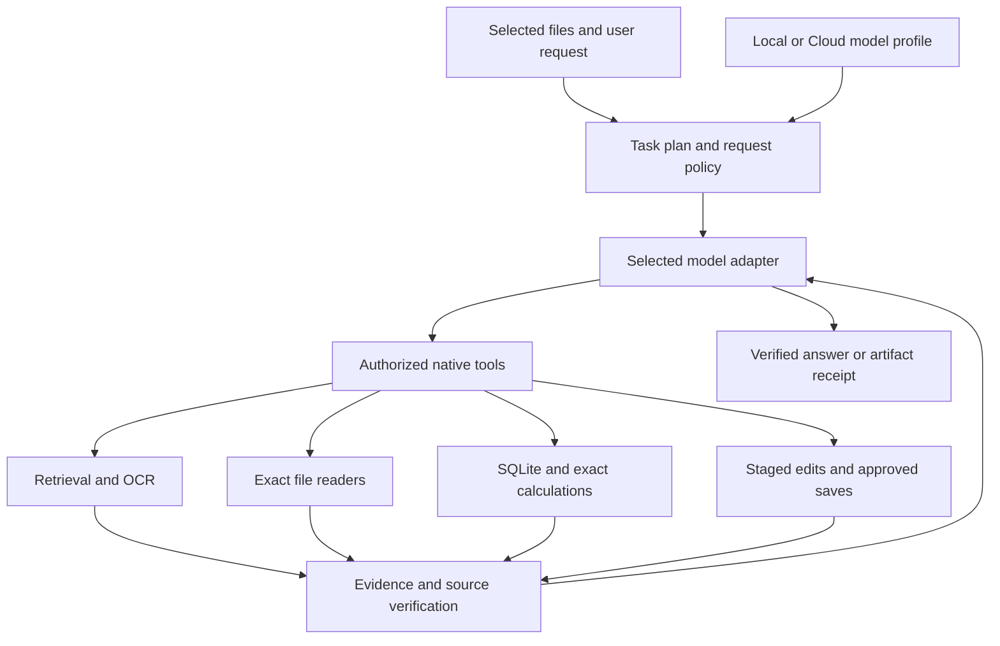

# Tools, file handling, and local/cloud model compatibility

Review date: **2026-10-10**. Scope: directory chat, shared agent loop, provider adapters, native inspection/editing, ingestion/OCR/retrieval, analytical tools, and model switching in the current working tree.

## 1. Recommendation

Use **one native file and evidence engine with selectable Local and Cloud chat profiles**. Keep extraction, indexing, exact reads, SQL, calculation, source checks, and approved saves in Nawa. The selected model plans tool calls and explains verified results.

Use the small local model for focused inspection, straightforward analysis, and small edits. Use a stronger cloud model for complex comparisons, ambiguous analysis plans, large document restructuring, and long reports. These are recommended workloads, not measured success guarantees. Neither model should calculate business totals from retrieval snippets or report a save without a commit receipt.

The implementation below applies the review recommendations. Model quality, live provider availability and GPU fit still need workload-specific evaluation; configuration and tool tests do not establish that every model handles every task.

## 2. Applied fixes

Implemented on **2026-10-10** in this working tree.

| Finding                                  | Applied change                                                                                                                                                                                                                                                                                                                                      | Verification                                                                                         |
| ---------------------------------------- | --------------------------------------------------------------------------------------------------------------------------------------------------------------------------------------------------------------------------------------------------------------------------------------------------------------------------------------------------- | ---------------------------------------------------------------------------------------------------- |
| Provider fallback / anonymous local auth | Preserve the chosen provider. Incomplete configuration errors stay on that provider. Custom streams and helpers allow an empty key. Keyless legacy endpoint settings migrate to Custom without cloud fallback.                                                                                                                                      | Provider resolution, legacy migration and keyless wire tests.                                        |
| Gemini signatures lost                   | Carry original ordered response parts through core and IPC; reuse them only for the same active Gemini model/endpoint. Preserve original call IDs when supplied. Strip provider state for a new request; reject token-limited tool calls.                                                                                                           | JSON and SSE fixtures with signed parallel calls, model mismatch, truncation, core and IPC checks.   |
| Incomplete context budgeting             | Every dispatch budgets full system, schemas, messages, opaque state, images and output reserve. Use llama.cpp rendered chat token counts when available and the conservative estimate is too large. Remove completed exchanges together and bound tool evidence without presenting omissions as complete reads. Reject an oversized active request. | Full-schema/system overflow, signed-chain preservation, tokenizer payload and receipt-preview tests. |
| Child edit and helper limits differ      | Directory chat and staged editor loops use the selected profile's loop policy. Streaming and helper dispatch use the same output policy; Codex helpers receive it too.                                                                                                                                                                              | Local/LAN/cloud policy isolation tests, source/type checks and all editor builds.                    |
| Profiles share one output cap            | Store per-profile context/output limits and Local server / Cloud API mode. Defaults: local 16,384 / 4,096; cloud 65,536 / 8,192. Output is capped at half the configured context; smaller task caps are allowed.                                                                                                                                    | Profile switching, normalization, invalid limits and browser controls.                               |
| API dialect ambiguity                    | Custom profiles can choose `max_tokens` or `max_completion_tokens`; Automatic selects the latter for the official OpenAI host and the former for generic servers. Native provider adapters retain their specific contracts.                                                                                                                         | Stream/helper dialect tests and adapter fixtures.                                                    |
| Text ping / assumed Custom vision        | Settings tests a synthetic tool call and tool-result follow-up. Optionally test image understanding. Bind results to model/endpoint; transient outages do not mark tools unsupported. Custom vision is off unless explicitly enabled or tested.                                                                                                     | Custom/OpenAI/Claude/Gemini round-trip fixtures, failed ping/outage tests, vision policy tests.      |
| Broader Codex fallback                   | Require the Nawa permission profile; delete a thread that ignored it. Reject unsupported versions before any turn. Output tokens remain advisory, with a conservative byte rejection before returning oversized tool calls.                                                                                                                         | Rejected/ignored profile and oversized-response tests.                                               |
| English-dependent evidence gates         | Add Arabic/Japanese/Chinese routing, Unicode quotes, conditional counts and save claims. Require visible analytical receipts based on executed queries, independently of inferred intent. Source versions and action receipts remain structured host evidence.                                                                                      | Multilingual route/quote/count/save tests and existing stale-source/unselected-file checks.          |
| Repeated work after interruption         | Persist structured per-file save outcomes even for failed/cancelled requests. Supply historical/current checkpoints; skip exact repeats in one request and match the full proposal digest on explicit resume. Keep partial outcomes for fresh review.                                                                                               | Actual history worker reload, duplicate commit and resumed-action tests.                             |
| Inconsistent format reporting            | Share native inspection/editing and analytical format lists; use the ingestion package's browser-safe catalog for search. Return operation capabilities with selected-file metadata. Show unsupported format guidance through status icons in the main files table.                                                                                 | Format matrix tests, ingestion tests and file-table browser checks.                                  |

### Request and evidence policy

The configured context ceiling is a user setting, not automatic certification of a model's advertised context or GPU capacity. Unknown tokenizers use conservative UTF-8 estimates and image reserves. These estimates can reject a request that would fit, and are not a universal image-token guarantee. llama.cpp b10107 provides full chat `input_tokens` counting; `/apply-template` plus `/tokenize` is a fallback, accepted only when the tool catalog is represented. The server may still reject a request when its actual ceiling is lower than the configured setting. [llama.cpp server documentation](https://github.com/ggml-org/llama.cpp/blob/b10107/tools/server/README.md).

Directory and staged local workflows use 24 model turns, 20 history messages, and mechanical compaction at approximately 24 KiB with an 8 KiB recent target. Cloud uses 60 turns, 40 messages and 128 / 32 KiB. Simpler routes keep their lower turn limit. All dispatches have the full request guard; the byte thresholds remain history controls. Native engines, approvals and final source checks apply under either model.

Checkpoint reuse is scoped to the same selected-file context. A historical save records a past outcome, not current file contents or permission to read another file. Explicit new edit instructions can still make a new change. Multi-file commits remain per file, not one batch transaction; partial actions need a fresh proposal and approval.

Prose checks remain heuristic. They do not prove the semantic truth of every sentence in every language. Structured source hashes, dataset generations, exact calculations and commit receipts are the authoritative execution evidence. Extended Claude thinking is not enabled; adding it would require preserving its opaque thinking blocks as well.

### Provider contracts

| Backend                                                  | Contract used                                                                             | Remaining verification boundary                                                                                                                                                      |
| -------------------------------------------------------- | ----------------------------------------------------------------------------------------- | ------------------------------------------------------------------------------------------------------------------------------------------------------------------------------------ |
| Local llama.cpp / Custom                                 | OpenAI-compatible tool calls/results, profile limits and optional rendered token counting | Test each model/template; this implementation has controlled fixtures, not a new live 4 GB benchmark.                                                                                |
| Direct OpenAI                                            | Chat Completions with `max_completion_tokens`                                             | Reasoning and visible output share its completion allowance. [OpenAI reference](https://developers.openai.com/api/reference/resources/chat/subresources/completions/methods/create). |
| Direct Claude                                            | Native Messages tool-use/result mapping; temperature omitted                              | Extended thinking is not represented as a supported feature. [Claude Messages guidance](https://platform.claude.com/docs/en/build-with-claude/working-with-messages).                |
| Direct Gemini                                            | Native streaming/schema conversion plus original signed parts                             | Schema conversion is a subset; native tool validation stays authoritative. [Gemini signatures](https://ai.google.dev/gemini-api/docs/generate-content/thought-signatures).           |
| DeepSeek, Kimi, GLM, Qwen, Doubao, MiniMax, xAI, Mistral | Shared OpenAI-compatible adapter with provider/model options                              | Individual endpoint/model versions have not all been exercised live.                                                                                                                 |
| Genspark, OpenRouter, Requesty, Opper, OpenCode Zen/Go   | Gateway routes, including native Claude/Gemini dialects where configured                  | A listed model ID is not verified availability; test the selected gateway route.                                                                                                     |
| Codex                                                    | Authenticated app-server with isolated profile and schema-constrained output              | No HTTP output-cap parameter; token allowance is advisory and oversized returned JSON is rejected.                                                                                   |

References: [request budget](../packages/ai-provider/src/request-budget.ts), [model policy](../packages/ai-provider/src/model-policy.ts), [capability test](../packages/ai-provider/src/capability-test.ts), [provider registry](../packages/ai-provider/src/registry.ts), [Gemini adapter](../packages/ai-provider/src/protocols/gemini.ts), [Codex integration](../packages/ai-provider/src/codex-app-server.ts), [action checkpoints](../apps/shell/src/renderer/src/directory-actions/evidence.ts).

## Follow-up fixes for reported failures

- “how may employee in employee-data.xlsx” now opens native analytical tools and receives the verified selected dataset schema before the first model call. A basic count requires no column. Premature column questions trigger schema/query correction; rejected drafts are removed from the visible chat. Genuine ambiguity and unavailable/changed tables still require a clear explanation.
- A Custom connection on localhost can be a cloud gateway. Recognized hosted model families now use cloud defaults unless the user explicitly selects Local server. The existing `gpt-6-luna` profile is covered; Gemma/LFM/GPT-OSS local defaults remain smaller. The endpoint and credentials do not change. Model-name hints do not prove the upstream host.
- OpenAI and GPT cloud request budgets now tokenize complete system/schema/history text locally with `js-tiktoken`, plus framing/image reserves and a 15% estimate margin. Legacy/modern encoding families use `cl100k_base`/`o200k_base`; future GPT aliases use the modern estimate. This fixes byte-count rejection of requests that fit the configured context. Other unknown tokenizers keep the conservative estimate; llama.cpp can supply rendered server counts. Explicit profile ceilings remain enforced, and errors identify estimated input, available input, context and output allowance. Chat framing, future aliases and image reserves are estimates, rather than an API usage guarantee. See [OpenAI tokenizer mappings](https://github.com/openai/tiktoken/blob/main/tiktoken/model.py).

## 3. Tool inventory and handling rules

| Area                           | Current tools / capabilities                                                                                                                                                  | Handling recommendation                                                                                                                         |
| ------------------------------ | ----------------------------------------------------------------------------------------------------------------------------------------------------------------------------- | ----------------------------------------------------------------------------------------------------------------------------------------------- |
| Selection and listing          | `list_directory`, `list_files`, `read_file`                                                                                                                                   | Freeze the selection per request. Read selected individual files only; folder selection grants metadata listing.                                |
| Capability discovery           | `discover_file_tools`                                                                                                                                                         | Keep lazy activation. Send only relevant schemas, especially to small models.                                                                   |
| Retrieval and exact inspection | `search_contents`, `inspect_file`, `query_file`, `close_inspection`                                                                                                           | Search locates candidate context. Native reads establish exact content. Close inspections before opening beyond the three-session limit.        |
| Table preparation              | `prepare_data`, `propose_table_policy`, `discover_datasets`, `describe_dataset`                                                                                               | Reuse current prepared data. Review ambiguous boundaries, hidden rows, formulas, units, and keys when necessary.                                |
| Calculation                    | `query_data`, `analyze_data`, `query_sql`, `inspect_result`                                                                                                                   | Prefer structured exact arithmetic. Use SQL for queries outside the structured API and preserve its numerical limitations.                      |
| Analysis export                | Conditional `export_sqlite` in the authorized preparation/export workflow                                                                                                     | An export is complete only when the tool returns a database path. Preparation alone is not publication.                                         |
| Native file operations         | `validate_file`, `convert_file`, `update_file`, `create_file`, `delete_file`                                                                                                  | Validate inputs, stage changes, inspect the result, and save through the approval flow.                                                         |
| Filesystem operations          | `rename_file`, `move_file`, `copy_file`, `create_folder`, `delete_folder`, `permanently_delete_file`                                                                          | Keep byte-preserving operations separate from conversion. Ordinary deletion uses the Recycle Bin; permanent deletion has explicit confirmation. |
| Optional MyAgent               | `discover_knowledge_tools`, `use_knowledge_tool`                                                                                                                              | Advertise only relevant server tools and readiness. Their index dependency must not block native reads or analysis.                             |
| Native editor tools            | Document blocks/operations; workbook cells, ranges, formulas, dependencies and operations; slide reads/operations; PDF pages, annotations/forms; Markdown and HTML operations | Use the actual advertised native schema. The host's read/edit whitelist remains authoritative.                                                  |
| Generation workflows           | Document writing, slide planning/generation, HTML planning, workbook merging, selected references                                                                             | Generate in bounded sections or operations; re-open and verify the produced artifact.                                                           |
| External resources             | Web/image search, media analysis/generation, downloaded resources                                                                                                             | Resolve their provider and permissions independently of the chat model.                                                                         |

The same native tools are available to local and cloud models. A model's ability to choose and sequence them correctly still needs workload testing.

### Existing strengths to retain

- Main-process authorization checks selection, workspace roots, file ownership, links, and saved-source hashes. Read-only inspections use snapshots and reject mutations.
- Analytical tools operate on selected Ready datasets. Read-only SQL uses SQLite's authorizer to restrict referenced tables and deny writes, attachment, and extension loading.
- Typed integer/decimal calculations preserve exact arithmetic. Results record source hashes, dataset generations, population, warnings, and display truncation.
- Edits use staged copies, preparation and save approvals, source rechecks, backups where applicable, and commit receipts. A first-page preview supplements native checks; it does not verify an entire document.
- Malformed or truncated tool arguments are rejected before execution. The loop requests smaller calls and bounds repeated failures. Transport watchdogs and limited retries handle stalled or empty responses.
- Saved model identities and credentials are kept separate. The directory model is propagated to native child workflows; its loop and dispatch budget follows the selected profile.

References: [file authorization](../apps/shell/src/main/directory-actions/file-safety.ts), [inspection manager](../apps/shell/src/main/directory-actions/inspection-manager.ts), [SQL authorization](../apps/shell/src/main/analytics/sql.ts), [action manager](../apps/shell/src/main/directory-actions/manager.ts), [agent loop](../packages/agent-core/src/loop.ts).

## 4. File coverage and accuracy boundaries

| File family                                                  | Native ingestion / retrieval                                                         | Exact native inspection                                      | Native analytical import               | Native editing                                         |
| ------------------------------------------------------------ | ------------------------------------------------------------------------------------ | ------------------------------------------------------------ | -------------------------------------- | ------------------------------------------------------ |
| DOCX                                                         | Yes, extracted structure/text; embedded-image OCR where available                    | Yes                                                          | No direct table dataset import         | Yes                                                    |
| XLSX                                                         | Yes                                                                                  | Yes: cells, formulas, ranges and supported structure         | Yes                                    | Yes                                                    |
| PPTX                                                         | Yes                                                                                  | Yes: slides and supported structure                          | No                                     | Yes                                                    |
| PDF                                                          | Text layer and OCR for pages without extractable text; partial extraction is flagged | Yes                                                          | No direct PDF-to-table dataset import  | Supported PDF operations                               |
| Markdown / HTML                                              | Yes; visual media and complex spans can be partial                                   | Yes                                                          | No                                     | Yes                                                    |
| CSV / TSV / JSON / JSONL / NDJSON                            | Yes                                                                                  | Text/extraction path, not a native editor inspection session | Yes                                    | No directory native edit host for these formats        |
| DOCM / DOTX / DOTM / XLSM / XLTX / XLTM / PPTM / PPSX / PPSM | Yes, extraction                                                                      | Outside the current native inspection allowlist              | XLSM only from this row                | Outside the current native edit formats                |
| Plain text / supported source and config files               | Yes, with text/line locators                                                         | `read_file` / extraction path                                | Only supported tabular formats         | No general source-code editing agent in directory chat |
| Images                                                       | OCR text when supported; does not establish visual meaning                           | No general image inspection host                             | No                                     | No native directory image editor                       |
| EML / ZIP                                                    | Bounded extraction; skipped content and partial coverage matter                      | No dedicated native inspection host                          | No direct archive/email dataset import | No                                                     |
| Legacy DOC / PPT                                             | Limited text extraction; layout fidelity is not established                          | No                                                           | No                                     | No                                                     |
| Legacy XLS / ODF / RTF                                       | Outside this native ingestion/analysis coverage                                      | No                                                           | No                                     | No                                                     |

Sources: [operation capability catalog](../apps/shell/src/shared/file-capabilities.ts), [ingestion dispatch](../packages/file-parse/src/rag.ts), [archive limits](../packages/file-parse/src/rag-archive.ts), [native formats](../apps/shell/src/main/directory-actions/inspection-manager.ts), [analysis formats](../apps/shell/src/shared/analytics-api.ts).

Important boundaries:

- Native RAG extraction rejects files above 64 MiB. Archive extraction caps entries and expanded content. Analytical import has separate configurable limits; increasing those does not increase the RAG limit.
- Local OCR relies on the Windows/macOS helper and recognition languages; the current Linux path lacks that helper. OCR text must be identified as recognized text when exact wording matters. It does not verify visual layout or understand a chart.
- Native inspections read saved bytes. Unsaved editor changes are outside their snapshot; editing requires a saved, closed source before staging.
- Spreadsheet import uses saved formula caches when explicitly accepted; it does not recalculate the workbook. Automatic policy approval leaves hidden-row, subtotal, changed-population, and saved-cache decisions for review.
- A structural row count is not automatically a unique employee/customer count. Prefer unique identifiers when the question asks for entities. Otherwise report records and make the business interpretation conditional.
- SQLite decimal columns store scaled integers. Arbitrary SQL `AVG`/REAL arithmetic is approximate and `SUM` can overflow. Do not copy internal exact-mean functions into SQL and assume automatic decimal rescaling.
- Joins can multiply rows. Typed joins enforce their supported relationship; arbitrary SQL still needs multiplicity and population checks.
- Complete aggregate input coverage is different from complete displayed output. A 490-product calculation can have a 20-product preview. State “showing 20 of 490” and offer a complete export through a supported workflow.
- Multi-file edits commit per file. There is no guaranteed batch transaction across all committed files. Record each outcome and resume remaining work without repeating completed saves.
- Current analysis supports its declared statistics and period attribution. It is not a general Python, machine-learning, forecasting, or unrestricted database tool environment.

References: [OCR](../apps/shell/src/main/rag/ocr.ts), [platform helper](../apps/shell/src/main/pdf2docx-local.ts), [preparation policy](../apps/shell/src/main/analytics/preparation.ts), [numeric SQL warnings](../apps/shell/src/main/analytics/sql.ts), [query compiler](../apps/shell/src/main/analytics/query.ts), [statistics](../apps/shell/src/main/analytics/statistics.ts).

## 5. Recommended task handling

| Task                                                          | Local small model                           | Cloud model                           | Shared execution path                                            |
| ------------------------------------------------------------- | ------------------------------------------- | ------------------------------------- | ---------------------------------------------------------------- |
| Find wording, a cell value, or a formula                      | Good starting workload                      | Also suitable                         | Narrow native read, source location, hash check                  |
| Count, sum, average, group, or filter a clear table           | Suitable with a simple plan                 | Useful for complex plans              | Full-population native calculation, bounded result               |
| Compare several files                                         | Process bounded sections sequentially       | Prefer for complex synthesis          | Retrieval to locate, exact reads to verify, cited comparison     |
| Small document/workbook edit                                  | Use precise, limited operations             | Also suitable                         | Staged edit, native checks, approval, commit receipt             |
| Large rewrite, complex formulas, or multi-file transformation | Split into independently verifiable steps   | Prefer a tested stronger model        | Plan, small operations, per-file checkpoints, final verification |
| OCR or image-heavy sources                                    | Use local OCR; do not assume chat vision    | Use a tested vision model when needed | OCR status plus original-image inspection for visual claims      |
| Long report or presentation                                   | Generate sections/slides in bounded batches | Prefer for coherent long synthesis    | Native artifact generation and re-open checks                    |

### Starting policies

These are engineering starting values to evaluate, not GPU-fit or task-quality benchmarks.

| Policy             | Local profile for the supplied 4B model                                              | Cloud profile                                                              |
| ------------------ | ------------------------------------------------------------------------------------ | -------------------------------------------------------------------------- |
| Chat context       | Start with the documented 16,384-token server profile; use the actual server ceiling | Discover/configure the selected model ceiling                              |
| Output per request | Usually 2,048–4,096; retain room for prompt and tools                                | Usually 4,096–8,192; 8,192–16,384 for long generation only when supported  |
| Model concurrency  | One request on the target machine                                                    | Bounded concurrency for independent work; edits serialized per target      |
| Tool exposure      | Only the current task's relevant schemas                                             | The same discovery mechanism, with more room if needed                     |
| Evidence           | Narrow ranges and small previews; retain full native receipts                        | Still bounded; larger context is not a reason to paste every selected file |
| Compaction         | Mechanical evidence/task digest                                                      | Verified digest; optional model summary with source references retained    |
| Editing            | Small operation batches                                                              | Larger planning scope, still bounded operations and verified saves         |
| Embedding          | Separate CPU embedding service/model; benchmark modest batches and concurrency one   | Keep the same index unless the embedding profile changes                   |

The local live test used the user's currently running server on a **6 GB GPU with a 128k configured context**. It proves a basic tool round trip on that server, not reliable fit or quality on a 4 GB GPU. See [local setup](LOCAL_LLAMA_CPP.md) for the proposed 4 GB starting profile. llama.cpp supports the relevant OpenAI-compatible chat and tool interface, but model/template behavior still matters. [llama.cpp b10107 server documentation](https://github.com/ggml-org/llama.cpp/blob/b10107/tools/server/README.md).

## 6. Switching models and keeping the UI simple

### Available now

1. Open **Settings → AI Model → Saved chat models**.
2. Configure Custom with `http://127.0.0.1:8082/v1`, alias `Agent-A1-4B`, and an optional key when authentication is required. Use **Add current model** and name it **Local**. In its collapsed **Advanced model settings**, set the actual context/output ceilings and run **Test model**.
3. Configure the desired cloud provider/model and its credential, add it as another saved model, and name it **Cloud**. Save settings.
4. Choose Local or Cloud in the chat's **Model** picker. Switch between completed requests; stop an active request before changing models and resubmitting.

The picker is disabled during active work. Completed directory history is reconstructed from accepted user/final messages with revalidated evidence rather than raw provider tool transcripts. Source changes can invalidate earlier evidence. Changing the chat model does not require rebuilding embeddings: index identity depends on the embedding/chunking profile.

References: [saved models UI](../apps/shell/src/renderer/src/ChatModelsEditor.tsx), [picker](../packages/ui/src/ChatModelPicker.tsx), [completed history](../apps/shell/src/renderer/src/directory-actions/evidence.ts), [embedding profile identity](../apps/shell/src/main/rag/config.ts).

### Product behavior

Keep the main flow **open directory → select files → ask**. Provide one Local/Cloud model picker and a clear current-model label. Put model limits, endpoint details, and capability diagnostics in collapsed main settings. Keep per-file indexing and analysis status in the main files table, with icons and hover details. Retain the Index action for explicit preparation, while allowing direct reads without indexing.

For a difficult local task, explain the concrete limitation and offer Cloud through that picker. Switching should retain selected-source identity, verified findings, and completed operations. It must not silently change providers, repeat committed edits, or grant additional file access.

Shared architecture:

## 7. Verification and remaining limits

Final implementation checks: **298 provider tests** (one opt-in live test skipped), **99 agent-core tests**, **784 shell tests**, **83 ingestion tests**, **17 slide vision/QC tests**, **2,778 spreadsheet tests** and **193 native spreadsheet engine tests** pass. Provider, shell, Docs, Sheets and Slides type checks pass. The desktop editors, CLI and shell were rebuilt. Theme-color and workspace-boundary checks pass.

Browser checks exercise real components with synthetic desktop bridges: **56 sidebar/settings checks**, **11 file-status checks** and **6 employee-count checks**, including narrow layouts, Arabic direction, collapsed per-profile limits, profile isolation, keyboard/hover progress and the Index action. Screenshots are in `.task/sidebar-review`, `.task/file-status-review` and `.task/employee-count-review`.

Earlier in the session a live llama.cpp tool round trip passed on the earlier adapter snapshot. During final implementation the endpoint at `127.0.0.1:8082` was offline. No paid cloud request or new live 4 GB GPU benchmark was run. The supplied server previously reported a 6 GB GPU and 128,000-token window; that is not evidence of fit or quality for the proposed 4 GB / 16K launch profile.

The protocol fixtures establish the implemented request/response contracts. They do not certify every gateway/model, every native operation, complex local planning, forecasting, OCR quality or arbitrary prose interpretation. Use the explicit model test and the workload matrix below for each deployment.

## 8. Evaluation gate before broad compatibility claims

Run the same controlled fixtures with Local and each supported Cloud profile:

- Exact quote, cell, formula, stale-file rejection, unselected-file denial, and saved-versus-unsaved content.
- Entity counts with duplicate IDs and blanks; exact decimal sums/means; hidden rows and saved formulas; joins with duplicate keys.
- Large grouped results: full input coverage, truthful preview size, correct units, and complete export when requested.
- Several file comparisons with inspection-session cleanup and bounded context.
- Staged edit, approve/reject, changed source before save, conversion/re-open, and partial multi-file failure.
- Tool JSON failure, truncated arguments, cancellation, timeout, active signed tool history, and switching between completed requests.
- Arabic/Japanese/English routing and evidence checks; vision-enabled and text-only profiles.

Measure correctness, unsupported claims, successful commits, tool calls, latency, prompt/output tokens, and recovery behavior. Passing a connection test or one tool call should not be presented as proof that a model handles all these tasks.

## 9. Delivery status

Provider isolation, Gemini signatures, shared dispatch budgeting, per-profile settings/testing, action checkpoints, multilingual checks and the shared format catalog are implemented and regression tested. Main settings contain model/embedding configuration; Chat retains its picker and ordinary question flow. File indexing and analysis progress remain in the main files table.

Remaining deployment work is live evaluation of the chosen models/endpoints and representative tasks, including memory fit on the actual 4 GB machine. Keep the accuracy and format boundaries in section 4 visible through source receipts and file-status hover details.
