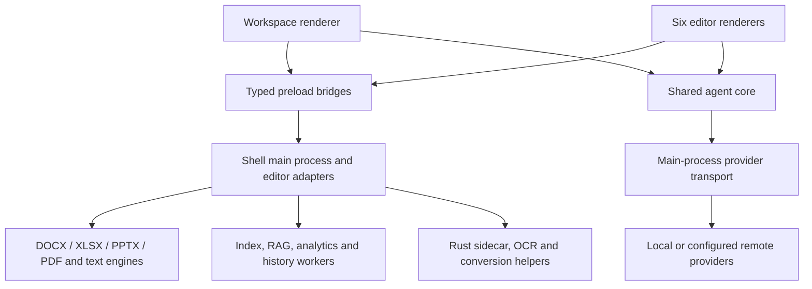
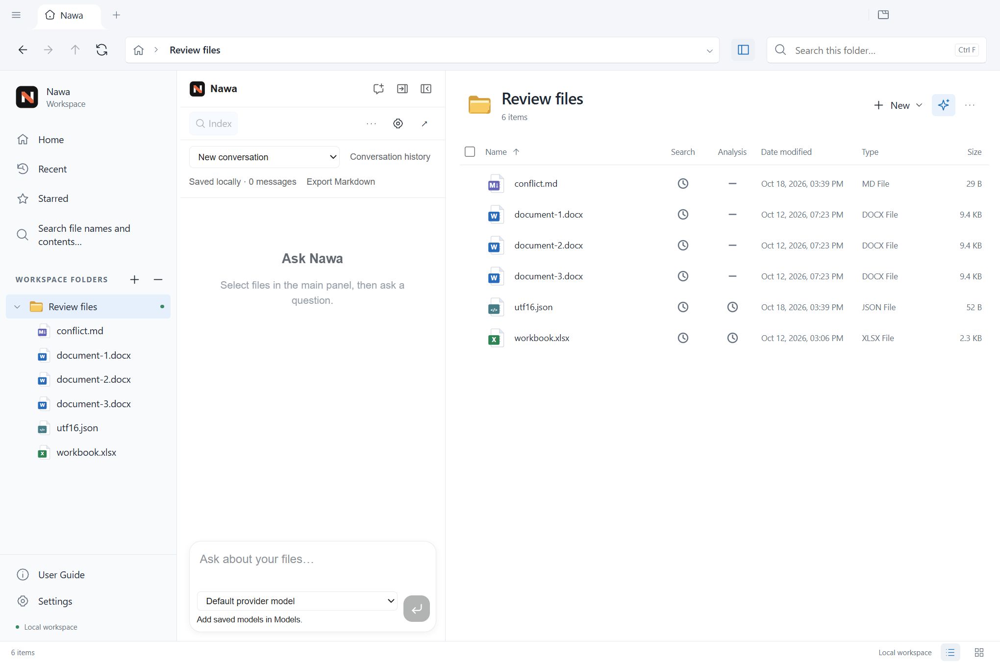
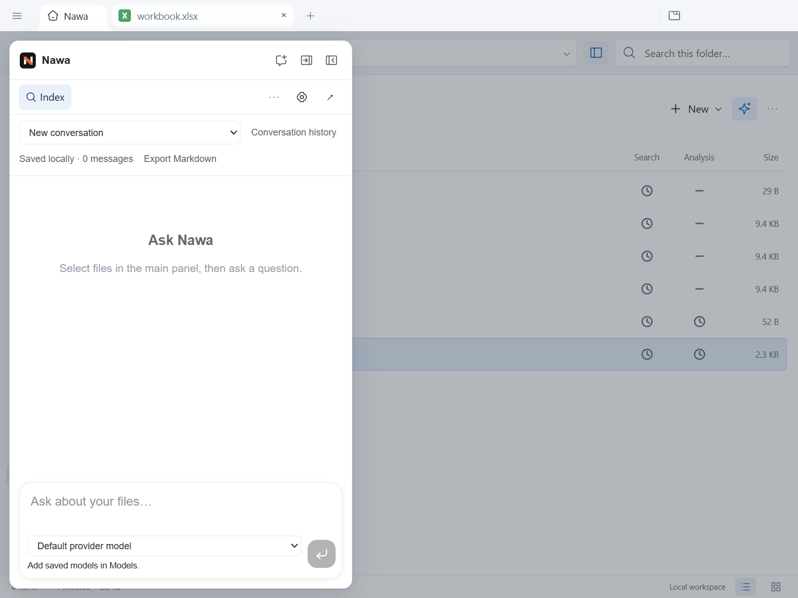

# Nawa comprehensive application review — 18 October 2026

Implementation follow-up: [remediation and validation record](nawa-remediation-2026-10-18.md). Findings below describe the pre-fix baseline. In particular, the suspected extra Sheets locale chunks were subsequently traced to document hyphenation dictionaries; those are retained for document fidelity.

**Assessment:** Nawa has strong document-engine and local-workspace foundations, but its save safety and renderer lifecycle need work before I would recommend it for irreplaceable documents. The immediate priorities are preventing file loss, preventing silent overwrites, and releasing resources when documents close. A visual redesign would not address those problems.

This reviews the current working tree, including the recent chat changes. It combines source inspection, Windows Electron scenarios, failure injection, dependency auditing, bundle measurements, and seven workspace test suites. It is a broad engineering review, not an exhaustive audit of every feature or a certification of Microsoft Office compatibility. Application source was not changed during this review.

**Priority findings**

P1 means address before the next release; P2 means schedule next; P3 means improvement after reliability work. “Reproduced” means a controlled probe demonstrated the behavior. “Inspected” means the conclusion comes from code or build artifacts, without asserting an observed user failure.

| ID  | Priority | Area                     | Finding                                                                                                                | Evidence                                                                                                    |
| --- | -------- | ------------------------ | ---------------------------------------------------------------------------------------------------------------------- | ----------------------------------------------------------------------------------------------------------- |
| R1  | P1       | Data integrity           | Interrupted PPTX saves can destroy the destination                                                                     | Reproduced: 102,645 bytes became 32 bytes after an injected write error                                     |
| R2  | P1       | Text/config accuracy     | Native text editing decodes UTF-16 as UTF-8 and can save corrupted content                                             | Reproduced: a 52-byte UTF-16 JSON file became 62 bytes with replacement characters and NULs                 |
| R3  | P1       | Save conflicts           | Markdown Save silently replaces changes made by another application                                                    | Reproduced through the actual editor IPC save path                                                          |
| R4  | P1       | Efficiency               | Closing Word tabs retains their WebContents until app exit                                                             | Reproduced: three closed documents retained three views and approximately 557 MiB additional private memory |
| R5  | P2       | AI accuracy              | Image/email chat stores output-limit cutoffs as successful answers                                                     | Reproduced with a local mock provider returning `finish_reason: length`                                     |
| R6  | P2       | Privacy/UX               | Local HTML previews can initiate network traffic before any AI action; the README says only AI calls leave the machine | Reproduced with a local HTTP receiver                                                                       |
| R7  | P2       | Accessibility            | File-chat resize handles cannot be operated with the keyboard                                                          | DOM and code inspection: `tabIndex=-1`, no value attributes or keyboard handler                             |
| R8  | P2       | Accessibility/design     | Light-theme chat placeholder contrast is insufficient                                                                  | Calculated contrast: approximately 3.05:1 for normal-sized text                                             |
| R9  | P2       | Architecture             | Save and chat lifecycle rules differ across adapters despite shared UI and engines                                     | Inspected; R1–R5 demonstrate the practical consequences                                                     |
| R10 | P2       | Performance/package size | Large editor entry bundles and unused locale chunks need a measured reduction plan                                     | Measured: Sheets entry JavaScript is 18.35 MB; all Sheets JavaScript totals 23.87 MB                        |
| R11 | P2       | Release engineering      | Desktop CI does not cover the native Windows application                                                               | Inspected: desktop Electron E2E is Ubuntu; the Windows workflow covers the browser service                  |
| R12 | P2       | Dependency maintenance   | Dependency advisories need artifact-specific triage and a CI policy                                                    | Audit: 15 dependency nodes flagged, including 5 high; these are not 15 demonstrated exploits                |
| R13 | P2       | Localization             | Several chat loading, stop, limit and transport messages bypass localization                                           | Inspected hardcoded English strings in shared workspace flows                                               |

**R1 — Make PPTX saving transactional**

[savePptxToFile](../../packages/pptx-engine/src/index.ts#L719) streams directly into `createWriteStream(filePath)`. That opens and truncates the destination before the ZIP stream finishes. Discarding the in-memory save receipt on failure does not restore the file.

The probe used a temporary copy of the fixture deck and injected a write error after 32 bytes. The save rejected, but the original 102,645-byte file had already been replaced by those 32 bytes. No repository fixture or user document was modified.

Stream into a temporary file beside the destination, complete and flush it, validate the result, and replace the destination only after success. Keep the original intact if replacement fails. Preserve the existing streaming behavior so large decks do not require one contiguous output buffer. Apply the same transaction to Save As and recovery writes, with the appropriate overwrite policy.

Acceptance: injected ENOSPC, stream failure and failed replacement leave the original byte-identical; successful saves reopen correctly; edits made during a save remain dirty for the next save.

**R2 — Reuse strict decoding in the native text editor**

The Markdown/text main process uses [UTF-8 reads](../../apps/markdown/src/main/markdown-main.ts#L566) and [UTF-8 writes](../../apps/markdown/src/main/markdown-main.ts#L437) for source files. A UTF-16 JSON fixture containing Arabic and Japanese decoded with replacement characters and embedded NULs. Saving that decoded text returned success and corrupted the original encoding.

The directory-editing path already has a suitable [strict decoder and matching encoder](../../packages/file-parse/src/source-text.ts#L1). Reuse that contract in native text/config editing: retain encoding and BOM, preserve line endings, and reject undecodable or binary content before it becomes editable. Display the detected encoding where it helps the user understand a conversion.

Acceptance: UTF-8 with/without BOM and UTF-16 LE/BE round-trip correctly; Arabic and Japanese remain intact; invalid sequences and unsupported encodings fail without changing the source. Include an actual open/edit/save/reopen test, not only a decoder unit test.

**R3 — Detect external changes before overwriting text files**

The [native Markdown save handler](../../apps/markdown/src/main/markdown-main.ts#L574) writes the current editor text without checking whether the disk source changed since opening. In the probe, another writer changed the temporary file after Nawa read it. Nawa then saved its older view successfully and erased the other writer's content without a conflict prompt.

Atomic replacement protects against an interrupted write; it does not protect against replacing a newer version. Docs and Sheets already contain external-change protections, so save behavior is inconsistent between file families.

Track a source revision on open and successful save. On mismatch, preserve the editor buffer and offer Reload, Save Copy, or an explicit overwrite decision. Audit HTML and Slides against the same contract; their safety should not be inferred from the Docs implementation. A revision check also needs a final commit boundary and cannot make unrelated OS writers participate in Nawa's lock.

Acceptance: external edits, cloud-sync replacement and file deletion never cause an automatic overwrite; failed saves retain the unsaved buffer and its original identity.

**R4 — Bound the lifetime of closed Docs renderers**

[Tab removal](../../apps/shell/src/main/tab-manager.ts#L756) intentionally detaches Docs views without closing their WebContents. The comment explains that destroying them caused an Electron UI freeze. That workaround avoids the freeze but retains the renderer until the app quits.

| Controlled session step             | Live WebContents | Sum of private memory | Sum of working sets |
| ----------------------------------- | ---------------- | --------------------- | ------------------- |
| Home                                | 1                | 407 MiB               | 521 MiB             |
| Two text tabs                       | 3                | 641 MiB               | 846 MiB             |
| Open and close first Word document  | 4                | 839 MiB               | 1,066 MiB           |
| Open and close second Word document | 5                | 991 MiB               | 1,257 MiB           |
| Open and close third Word document  | 6                | 1,198 MiB             | 1,491 MiB           |

The document views remained present after their tabs disappeared. These are single-session measurements, not universal per-document costs. Working sets include shared pages and should not be interpreted as unique physical RAM. Private-memory growth provides the more useful comparison here.

Do not simply remove the workaround and reintroduce the freeze. Isolate its minimal reproduction, evaluate a compatible Electron fix, or implement a bounded renderer-reuse/disposal strategy that fully clears document state. Add a native Windows lifecycle test.

Acceptance: repeated open/close cycles do not produce linear growth in live document views or private memory, while dirty-close prompts and the UI remain responsive.

**R5 — Preserve incomplete AI outcomes in preview chat**

[PreviewAssistant's completion callback](../../apps/shell/src/renderer/src/PreviewAssistant.tsx#L212) finishes the message without distinguishing output truncation or turn-limit outcomes. Its [history restore filter](../../apps/shell/src/renderer/src/PreviewAssistant.tsx#L232) then accepts non-error, non-streaming messages.

A local mock OpenAI-compatible endpoint returned a sentence ending midway through a phrase, followed by `finish_reason: length`. The stored assistant message had `streaming: false` and `error: false`, with no incomplete-response notice. The directory chat already handles this outcome more carefully.

Use a common completion contract for completed, stopped, failed, output-limited and turn-limited runs. Keep partial text visible, label its state, and offer continuation or retry. Persist the outcome so reopening a conversation does not promote incomplete output into a successful answer. Preview messages also record `snapshotHash`; history reuse should explicitly account for changed snapshots rather than relying only on a prompt describing them as older.

Acceptance: deterministic mocked-provider tests cover each terminal state, persistence/reopen, model changes and preview refresh. No paid or external AI service is required for these tests.

**R6 — Make HTML network behavior explicit**

The [HTML preview](../../apps/html/src/renderer/preview/PreviewFrame.tsx#L23) deliberately permits scripts and network access for authored pages and CDN-dependent content. Opening a local fixture caused its script to contact a local HTTP receiver before any AI request. This demonstrates the network capability; it does not demonstrate a sandbox escape or arbitrary filesystem access.

That behavior conflicts with the [README's claim](../../README.md#L49) that only AI calls leave the machine. Sandboxing the preview is valuable, but it does not prevent the page from transmitting content already available to its scripts.

Offer an understandable remote-content policy for local HTML, ideally with network access blocked until enabled for that document. Retain an explicit option for pages that need remote assets. Update privacy wording to account for preview resources and other optional network features. Also add an explicit session permission policy for untrusted preview content; no permission request/check handler was found in the inspected source. This follows [Electron's security guidance](https://www.electronjs.org/docs/latest/tutorial/security).

Acceptance: opening an untrusted local HTML file in restricted mode produces no remote requests; enabling remote content is visible and reversible; preview code still cannot reach privileged app APIs.

**R7–R8 — Complete the accessibility contract**

The inspected [file-chat resize handle](../../apps/markdown/src/renderer/ai/AiPanel.tsx#L805) is pointer-only. In the live DOM it had `tabIndex=-1` and no `aria-valuenow`, minimum or maximum. The directory [Splitter](../../apps/shell/src/renderer/src/explorer/Controls.tsx#L36) already supports focus, arrow keys, Home/End and value semantics. Reuse that behavior for every editor and preview. The expected interaction is described by the [W3C window splitter pattern](https://www.w3.org/WAI/ARIA/apg/patterns/windowsplitter/).

The [chat placeholder](../../packages/ui/src/chat-panel.css#L250) uses [the tertiary text token](../../packages/ui/src/tokens.css#L63), `#909499`, on white. Its calculated contrast is approximately 3.05:1 at a normal 16 px font size. Adjust the semantic color to reach at least 4.5:1 in this context; changing it globally requires checking its other uses. [WCAG's contrast guidance explicitly includes placeholder text](https://www.w3.org/WAI/WCAG22/Understanding/contrast-minimum.html).

Native chat logs also differ in live-region semantics. Test complete-answer announcements with NVDA and VoiceOver rather than announcing every streamed token. Pointer testing alone cannot establish screen-reader usability.

Acceptance: all chat widths can be changed without a mouse on either physical side, including Arabic; focus is visible; the value and controlled pane are announced; enabled text and placeholders meet contrast requirements in all themes.

**Architecture and maintainability**

The core organization is appropriate for this product: a desktop shell owns files, windows and privileged services; isolated views host specialized editors; shared packages implement the document engines and agent machinery. Local search, RAG and analytics use separate worker/service boundaries. A Rust sidecar supplies spreadsheet operations. The optional browser service reuses editor capabilities behind a narrower authenticated policy.

The strongest boundaries should be preserved: specialized document models, sandboxed renderers, typed IPC, versioned evidence, staged directory edits and capability allowlists. The shared-package boundary check passes.

R9 concerns ownership within those boundaries. Important behavior is still spread among large adapter/components: PDF `App.tsx` is 10,545 lines, Docs `App.tsx` is 8,088, Sheets synchronization is 8,048, Slides main is 5,374, and shell main is 3,976. Size alone is not a bug. It makes cross-editor changes harder to reason about, and the reproduced differences in saving and chat outcomes show where shared contracts are missing.

Extract small contracts around `FileSession`, safe save transactions, source revisions, chat outcomes and renderer disposal. Keep engine-specific editing behind adapters. Do this one behavior at a time, with its existing tests, rather than replacing the application architecture.

Nawa also has several representations of the same file: saved bytes, a live editor buffer, an isolated editing stage, extracted/indexed data, and conversation evidence. Make the source version and saved-versus-live distinction explicit at each read boundary. The UI should explain freshness when it changes what an answer means, especially when native file chat and directory analysis use different snapshots.

The visual system is improving: shared chat primitives and semantic theme tokens now connect previously separate surfaces. There are still overlapping token families (`--text`, `--color-text-primary`, Explorer tokens) and substantial specificity overrides. Define a documented token mapping and a small set of shared surface components before adding more overrides.

**Design and UI/UX**

The workspace metaphor is understandable: folder navigation, central file views, document tabs and adjacent chat. The recent unified Nawa header, conversation selection, message actions and background treatment improve continuity between file types. Theme rules correctly separate application chrome from authored document colors.

At a 1,024 px viewport, the directory assistant became a drawer without horizontal document overflow. Escape dismissed it, and Settings was accessible after dismissal. No unnamed visible buttons were found by the limited DOM check on that workspace screen. These are positive checks, not a complete accessibility audit.

The next design work should simplify decisions:

- Keep the selected files and answer source clear. Explain when a request uses saved content, live edits, OCR or a prepared table.
- Reduce persistent chat chrome. History selection, history management, saved status, export, indexing, settings and expansion currently compete above the transcript. Keep frequent controls visible and group occasional actions into a consistent menu.
- Explain Search versus Analysis readiness in user language. A clock or dash alone does not tell a new user what they need to do or why a file cannot yet answer a question.
- Show capabilities at the point of action: editable native file, imported copy, read-only image/email, missing converter, or unavailable OCR. Avoid letting a successful open imply native round-trip support.
- Make first-run setup support the user's chosen route: local model, provider key, or account sign-in. The Account screen's sign-in emphasis is not equally useful to all three.
- Keep error, stopped, incomplete, unsaved and conflict states visually consistent with normal states. These states deserve the same localization and keyboard coverage as the happy path.

These are design recommendations, not claims that the corresponding features are absent. No end-user usability study was performed.

**Accuracy and file fidelity**

| Area                        | Existing strengths                                                                                               | Remaining validation needed                                                                                                                   |
| --------------------------- | ---------------------------------------------------------------------------------------------------------------- | --------------------------------------------------------------------------------------------------------------------------------------------- |
| Modern Office files         | Shared engines, package-part preservation tests, format-aware saves, macro/template handling                     | Reopen representative edited files in Word/Excel/PowerPoint; compare supported feature semantics and rendering, not just ZIP validity         |
| Legacy/OpenDocument imports | Explicit conversion paths, bounded conversion processes, original-source preservation and documented limitations | Converter-present/missing cases on each OS; fonts, tables, charts, animations and clear copy-save identity                                    |
| Spreadsheet answers         | Reviewed table policies, source versions, precise-number handling and warnings for cached formulas               | An independent expected-results corpus for dates, locales, blanks, duplicate IDs, decimal totals, hidden data and stale formula caches        |
| PDF                         | Dedicated edit/save paths, annotations, forms, redaction and signature logic                                     | A save/reopen/export corpus covering Arabic/Japanese fonts, scanned pages, forms, signatures and redaction removal across viewers             |
| Text/config                 | Source editing modes and an existing strict decoder for directory edits                                          | Resolve R2/R3; test encoding, newline and external-change behavior through native editors                                                     |
| Images/emails               | Explicit first-frame/page and attachment-inventory limits; vision/OCR separation                                 | OCR errors, long messages, unavailable helpers, snapshot refresh and incomplete chat outcomes                                                 |
| AI/RAG                      | Bounded tool results, source checks, approval gates, incomplete-outcome handling in directory chat               | Deterministic cross-panel outcome tests plus a scored answer/evidence benchmark; prompts and citations alone do not prove factual correctness |

Retrieval relevance, numerical correctness, document fidelity and model answer quality are different measurements. Keep their tests and reported guarantees distinct. Current analytics readers correctly warn about external links and potentially stale saved formula caches; preserve those warnings through the final answer.

Real external model accuracy, hallucination rate and retrieval recall were not measured here. The AI failure reproduction used a local deterministic endpoint and consumed no paid API calls.

**Performance, size and developer efficiency**

R10 is supported by the current built artifacts. These are raw JavaScript bytes, excluding CSS, fonts, WASM and native binaries. They are not installer sizes or measured parse times.

| Renderer | Largest entry/chunk | All JavaScript |
| -------- | ------------------: | -------------: |
| Shell    |             1.96 MB |        2.42 MB |
| Docs     |             6.41 MB |        8.74 MB |
| Sheets   |            18.35 MB |       23.87 MB |
| Slides   |             4.05 MB |        4.05 MB |
| PDF      |             2.73 MB |        2.73 MB |
| Markdown |             5.07 MB |       12.55 MB |
| HTML     |             2.47 MB |        2.47 MB |

Sheets still emits chunks named for unsupported locales, including a 765 KB `hu` chunk, despite the application locale loader offering English, Japanese and Arabic. This does not mean those languages are selectable. Trace the transitive imports before deciding what can be excluded safely.

Prioritize R4 before micro-optimizations. Then profile module loading and editor readiness; defer optional diagramming, advanced panels and unused locale/data packs where practical. Enforce per-renderer budgets and measure cold start, full file-ready time, tab switching, save latency and memory over a session.

In controlled source-build launches, shell controls appeared in roughly 0.95–1.15 seconds. A separate Home-plus-Sheets session used approximately 702 MiB summed private memory and 876 MiB summed working sets. These are observations on this machine with spare-view prewarming disabled, not production benchmarks or a claim that the workbook was fully ready at the first chat-header paint.

The source launcher rebuilds every editor and CLI by default. `-SkipBuild` exists, but a useful development improvement is dependency-aware incremental builds and stale-output detection. The existing 0.10.0 installer in `release` predates this review, so its size is not evidence for the current source tree. A new installer was not produced.

**Security, privacy and dependencies**

The inspected windows use context isolation, sandboxing and disabled Node integration. Renderer CSPs are restrictive. API-key storage uses OS encryption and refuses insecure storage, with revision checking for settings. Directory operations have source-hash checks, staging, path authorization, capability checks and review/approval boundaries. The local control channel uses a random token and bounded requests. These are meaningful strengths.

R12 needs careful triage. `npm audit` reported 15 affected dependency nodes: 5 high and 10 moderate, with no critical findings. `--omit=dev` reported 5 moderate and no high findings. Neither result is an exploitability assessment: packages declared as development dependencies can still be bundled into a shipped Electron application.

In particular, the `node-forge` advisory concerns RSA signature verification. Nawa's [PDF signature path already uses Node/OpenSSL verification](../../apps/pdf/src/main/pdf-signatures.ts#L507) with an explicit mitigation comment. Do not report that advisory as a demonstrated signature bypass in Nawa. Build-time watcher and packaging advisories likewise need their actual invocation paths assessed.

Add advisory review against the lockfile and packaged inventory, with documented mitigations/waivers and expiry dates. Avoid automatic forced dependency changes without compatibility testing. The current CI checks licenses but does not contain an npm advisory gate. HTML network behavior remains the reproduced privacy issue in R6. Local indexes and chat storage also need clear retention/removal controls; the knowledge documentation already discloses that its index is not encrypted.

**Localization and international use**

The manual coverage check passes for 18 topics in English, Japanese and Arabic. Language catalogs and structural checks are a good foundation, and the prior file-view smoke checks covered Arabic direction without moving the physical layout.

R13 remains in user-visible states: [loading history](../../apps/shell/src/renderer/src/WorkspaceChat.tsx#L350), [output-limit notices](../../apps/shell/src/renderer/src/WorkspaceChat.tsx#L1564), and [transport errors](../../apps/shell/src/renderer/src/ai/transport.ts#L5) contain hardcoded English. Move these to the locale dictionaries. Do not add the unstable translation function to effect dependencies as a quick lint fix; the repository documents that constraint.

Test language switching while streaming, editing a question, resolving a conflict, restoring recovery and displaying a conversion error. Also test mixed Arabic/Latin paths and Japanese IME composition. A complete dictionary does not establish those interactions.

**Validation and release confidence**

| Check                        | Result                                                                                                                                         |
| ---------------------------- | ---------------------------------------------------------------------------------------------------------------------------------------------- |
| Root `npm run typecheck`     | Passed                                                                                                                                         |
| Root `npm run lint`          | Passed with 21 warnings, zero errors                                                                                                           |
| Shared-package boundary gate | Passed: 521 package source files                                                                                                               |
| Help language coverage       | Passed: 18 topics × 3 languages                                                                                                                |
| Shell suite                  | 1,268 passed; 4 skipped                                                                                                                        |
| Agent core suite             | 189 passed                                                                                                                                     |
| File parsing suite           | 149 passed                                                                                                                                     |
| File formats suite           | 32 passed                                                                                                                                      |
| DOCX engine suite            | 1,713 initially passed; 3 timed out under concurrent load; all 3 passed in a focused rerun; 1 skipped                                          |
| PPTX engine suite            | 1,245 passed; 17 skipped                                                                                                                       |
| XLSX gateway suite           | 253 passed                                                                                                                                     |
| Controlled probes            | PPTX interrupted save, UTF-16 corruption, external overwrite, Docs renderer retention, preview truncation and HTML network behavior reproduced |
| Narrow workspace             | No horizontal overflow at 1,024 px; drawer Escape dismissal passed                                                                             |

Across the seven workspace suites, **4,852 distinct tests passed after the focused timeout rerun; 22 were skipped**. The injected-failure diagnostic is additional and intentionally asserts the observed defect; it is not a product regression test proving safe behavior. The initial three DOCX timeouts were not assertion failures and did not recur with one worker.

R11 is a release gap: [desktop Electron E2E runs on Ubuntu](../../.github/workflows/ci.yml#L171), while [the Windows job targets the browser service](../../.github/workflows/browser-windows.yml#L21). Add a native Windows smoke gate covering open/save/reopen, dirty close, repeated tab disposal, external conflicts, locale switching and packaging resources. Test installed builds as well as source builds.

This review did not rerun every workspace suite, the complete Electron E2E corpus, every Rust test, or a fresh installer build. It did not validate macOS/Linux behavior, OS default associations, update signatures, screen-reader behavior or full Office visual parity. Earlier broad probe attempts encountered an incorrect test selector and normal modal pointer blocking; the corrected UI probe passed. Those harness issues are not application defects.

**Recommended work order and acceptance gates**

| Order | Work                                                                                                       | Completion evidence                                                                                        |
| ----- | ---------------------------------------------------------------------------------------------------------- | ---------------------------------------------------------------------------------------------------------- |
| 1     | R1–R3: safe saves, strict text codecs and conflicts                                                        | Failure-injection plus native open/edit/save/reopen tests; originals survive every failed write            |
| 2     | R4: renderer lifecycle                                                                                     | Repeated native Windows open/close test with bounded views and memory, without UI freezes                  |
| 3     | R5–R8 and R13: trustworthy chat outcomes, privacy behavior, keyboard access, contrast and localized states | Deterministic provider tests, network-policy tests and keyboard/assistive-technology scenarios             |
| 4     | R9–R12: shared contracts, measured bundle reduction, Windows release gate and dependency triage            | Adapter conformance tests, artifact budgets, installed-build smoke results and reviewed advisory inventory |
| 5     | Product refinement                                                                                         | Usability sessions for file selection, Search/Analysis readiness, chat history and local-model setup       |

Prefer this sequence over adding more file formats immediately. Broad support is useful only when users can trust saving, understand what the assistant read, and work through a long session without accumulating hidden editors.

Sanitized measurements and validation results are stored in [evidence.json](nawa-review-2026-10-18/evidence.json). The local reproduction scripts and full logs are in `.task/nawa-review-*` in this checkout.
